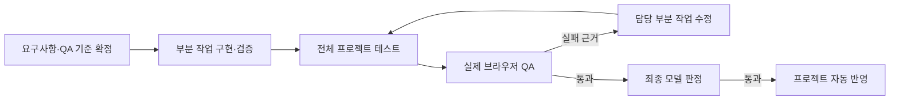
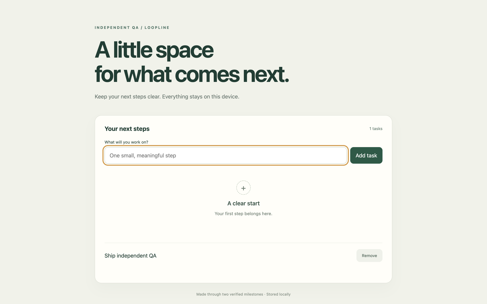
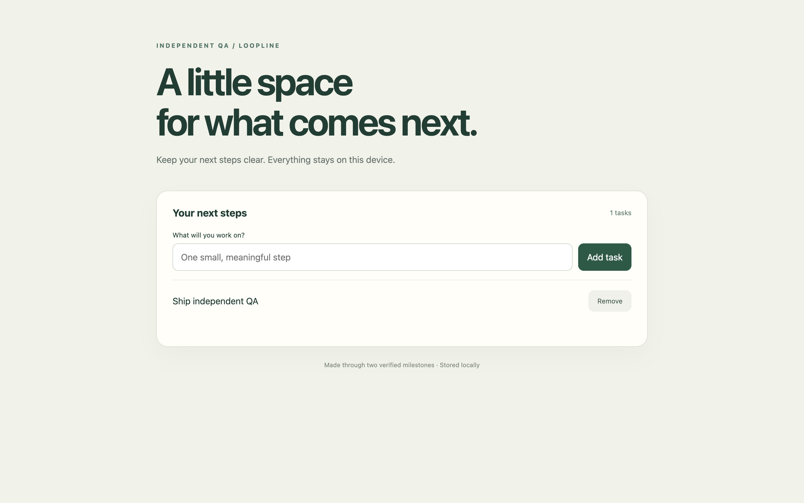
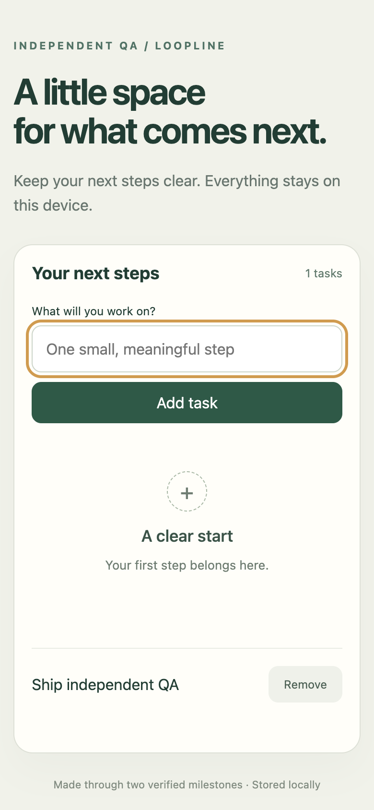
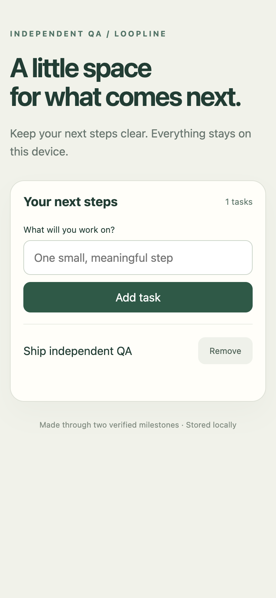

# Loopline Agent 도구 연결 및 자동 완료 보강 보고서

작성일: 2026-10-01

## 작업 완료 요약

Agent별 기존 Plugin의 MCP 도구·Skill 연결을 추가했습니다. 이어서 요청한 순서대로 자동 반영 전 독립 브라우저 QA, 모델 선택에 전달할 실측 기록, 부분 작업 완료 근거와 전체 통합 검증을 구현했습니다.

최종 앱 테스트는 **183/183 통과**했습니다. 패키징한 실제 Loopline 데스크톱에서 Paper 가이드 읽기 → 부분 작업 두 개 구현 → 브라우저 결함 발견 → 다음 회차 수정 → 재검증 → 자동 반영까지 확인했습니다. 생성된 코드에는 실행 시작 후 사람이 수정한 부분이 없습니다.

이번 검증은 **로컬 통제 모델 응답과 실제 Chromium 브라우저를 사용한 기능 QA**입니다. 실제 상용 모델의 구현 품질·시간·토큰 비용을 비교한 벤치마크로 해석하지 않습니다.

## 1. Agent별 Plugin·Skill·MCP 연결

| 연결 | 구현 범위 | 확인 결과 |
| --- | --- | --- |
| Codex 기존 연결 | 선택한 계정의 MCP 목록·도구 호출과 Skill 검색·읽기 | 계정 격리 회귀 테스트 통과. 현재 환경에서 Paper 도구 35개 탐색 및 가이드 읽기 성공 |
| Claude 기존 연결 | 사용자·프로젝트 MCP 설정, 설치 Plugin의 MCP 선언과 Skill 폴더 | 설정·환경 변수·프로젝트 범위 테스트 통과. 현재 환경에는 실제 Claude Plugin/MCP 등록이 없어 실서비스 호출은 미검증 |
| Loopline 공통 MCP | 역할별로 기존 공통 MCP 도구를 제공 | 실제 앱의 계획 단계에서 Paper `get_guide` 호출 1회 완료 |
| API 모델 | API 자체 Plugin 연결 대신 Loopline 공통 MCP 제공 | 로컬 테스트 연결로 도구 요청과 결과 전달 확인 |
| Jev 판정 | 기존 판정 전용 연결 유지 | 실행 도구를 제공하지 않고 판단에 필요한 근거를 전달 |

Harness 구성에 각 역할의 **이 Agent의 Plugin·Skill·MCP 사용**, **Loopline MCP 사용** 옵션을 추가했습니다. 사용하지 않는 연결은 시작하지 않으며, 원본 프로젝트 설정은 임시 작업 공간에서도 유지합니다.

Codex 도구 연결은 기존 계정으로 `mcpServerStatus/list`, `mcpServer/tool/call`, `skills/list`를 사용합니다. 임시 도구 세션은 실행 후 닫고, MCP가 없는 계정에는 불필요한 임시 대화를 만들지 않습니다. [공식 App Server 문서](https://learn.chatgpt.com/docs/app-server)

Claude는 기존 설정과 설치된 Plugin의 선언을 읽습니다. 새로운 로그인이나 권한을 만들지 않습니다. 현재 연결 방식에서 지원하지 않는 인증·전송 방식은 사용할 수 없는 연결로 처리합니다. [Claude MCP 문서](https://code.claude.com/docs/en/mcp), [Claude Plugin 구성 문서](https://code.claude.com/docs/en/plugins-reference)

## 2. 자동 반영 전 독립 브라우저 QA

실행 흐름은 다음과 같습니다.



웹 작업은 입력·저장·새로고침·빈 상태·키보드 조작을 검사하고, 1440×900 데스크톱과 390×844 모바일에서 실제 화면을 확인합니다. 검사 계획은 구현 전에 확정해 보존하며, 입력이나 새로고침을 실행한 뒤 실제 결과를 확인하는 assertion이 있어야 합니다.

모델의 통과 판정으로 브라우저 실패를 덮어쓸 수 없습니다. 실패 단계와 화면 근거를 다음 구현 회차에 전달하며, 최종 브라우저 검사와 전체 검증을 모두 통과한 뒤 반영합니다. 브라우저 실행기가 없는 일반 서버 환경도 QA 통과로 처리하지 않습니다.

### 실제 데스크톱 검증

저장 모듈과 반응형 화면으로 나눈 Quiet Ledger 웹사이트를 제작했습니다. 테스트 응답은 모델 판정이 항상 통과하도록 구성했고, 최초 CSS에는 빈 상태의 `hidden` 속성을 덮어쓰는 결함을 넣었습니다.

| 항목 | 실제 결과 |
| --- | --- |
| Paper 연결 | 계획 단계 `get_guide` 읽기 1회 성공. 디자인 파일 수정 없음 |
| 1회차 | 저장 모듈 구현 및 5개 내부 테스트 통과 |
| 2회차 | 화면 구현 및 3개 내부 테스트 통과. 전체 내부 테스트 8/8 통과 |
| 2회차 독립 QA | 10개 중 8개 통과. 데스크톱·모바일 저장 검사에서 빈 상태가 계속 보이는 결함 발견 |
| 반영 차단 | 모델 판정이 통과했어도 독립 QA 실패로 원본 반영 차단 |
| 3회차 | 실패 근거를 전달해 `styles.css`만 수정 |
| 최종 독립 QA | **10/10 통과** |
| 최종 부분 작업 | **2/2 완료**, 각 부분의 검증 근거 보존 |
| 최종 프로젝트 테스트 | **8/8 통과** |
| 자동 반영 | 완료. 반영 이벤트 시각이 최종 QA 완료 시각 이후임을 확인 |
| 실행 시작 이후 생성 코드의 사람 수정 | **0회** |
| 자동 복구 기록 | 브라우저 QA 실패 **1회**, 모델 재시도 0회, 부분 검증 실패 0회 |
| 전체 실행 시간 | **14.487초** — 통제 응답을 사용한 로컬 실행 시간 |
| 기록된 호출·토큰 | 19회·285토큰 — 테스트 서버가 고정 반환한 합성 사용량 |

첫 번째 별도 실행도 3회차에 자동 완료했습니다(13.546초, 18회 호출, 합성 270토큰). 두 실행의 기능 시나리오는 동일하며, 두 번째 실행에는 실제 Paper 읽기가 추가됐습니다. **두 번의 성공으로 일반적인 최종 성공률 100%를 주장하지 않습니다.**

### 화면 비교

아래 이미지는 모델이 제시한 시안이 아니라 독립 QA 실행기가 실제로 캡처한 화면입니다. Before는 작업이 추가됐는데 빈 상태도 보이는 실패 화면이며, After는 다음 회차에서 수정한 뒤 저장·새로고침 검사를 통과한 화면입니다.

| Before | After |
| --- | --- |
|  |  |
|  |  |

[비교 화면 열기](loop-agent-qa-evidence-milestones-2026-10-01.html) · [최종 실행 근거 JSON](assets/agent-independent-qa-2026-10-01/paper-desktop-evidence.json)

## 3. 실측 기록으로 모델 선택 강화

작업 유형, 역할, 모델, Effort별로 호출 시간·기록 토큰·완료 여부·독립 QA 결과·복구 횟수를 축적하고 자동 선택의 판단 자료로 전달합니다. 브라우저 QA 실패와 부분 작업 실패도 복구 횟수에 포함합니다.

- 실행 ID별로 기록을 교체하므로 중단 후 이어가기 때문에 같은 실행이 중복 집계되지 않습니다.
- 사용량이 제공되지 않은 호출은 0토큰으로 기록하지 않고 미확인으로 남깁니다.
- 같은 작업 유형·역할·Effort의 표본이 3개 미만이면 성능 우위로 사용하지 않습니다. 3회 기준은 운영상 최소 표본 기준이며 통계적 유의성을 의미하지 않습니다.
- 혼합 모델 실행의 결과는 해당 조합의 관찰값입니다. 특정 모델 하나의 인과적 성능으로 표시하지 않습니다.
- 사람의 공수는 실제 계측 전까지 미측정으로 남깁니다. 이번 QA의 생성 코드 수동 수정 0회는 직접 확인한 별도 기록입니다.
- 이번 로컬 통제 응답의 기록은 QA 산출물로 옮겨 실제 모델 선택 통계에 남기지 않았습니다.

이번 작업은 기록과 선택 근거의 연결을 검증했습니다. 실제 모델 간 우위와 비용 절감률은 같은 요구사항으로 여러 번 실행한 별도 벤치마크가 필요합니다.

## 4. 큰 프로젝트의 부분 완료 관리

큰 작업은 2~8개의 검증 가능한 부분으로 나누고, 각 부분에 담당 파일·완료 기준·의존 관계·검증 명령을 확정합니다. 활성 부분의 파일만 수정하고, 테스트와 판정 근거 및 파일 해시를 보존합니다.

나중 회차에서 완료된 부분의 파일이나 의존 항목이 바뀌면 이전 완료 근거를 무효화하고 재검증합니다. 부분 완료 후에도 전체 테스트·독립 브라우저 QA·최종 판정을 통과해야 반영합니다. 통합 검사에서 문제가 생기면 판정 역할이 수정할 부분을 선택하고, 영향을 받지 않은 부분의 근거는 유지합니다.

## 5. 검증 및 패키징

| 검증 범위 | 결과 |
| --- | --- |
| 전체 앱 회귀 테스트 | `node --test tests/*.test.mjs` — **183/183 통과**, 실패·취소·누락 0 |
| 마지막 Plugin·브라우저·실측 집중 검사 | **21/21 통과** |
| 생성된 최종 웹사이트 내부 테스트 | **8/8 통과** |
| 실제 앱의 브라우저 검사 | **10/10 통과**, 실패 → 수정 → 재검사 경로 확인 |
| 실제 Paper 읽기 | Codex 기존 연결 경로와 Loopline 공통 MCP 계획 단계에서 성공 |
| 데스크톱 패키징 | `npm run desktop:package` 성공, 패키징된 앱 실행 및 완료 화면 확인 |
| 변경 공백 검사 | `git diff --check` 통과 |

검증 중 발견한 패키징 경로 오류, CSS 숨김 상태 판정 오류, 입력·새로고침 이후 확인 누락, Claude 기본 Skill 폴더 탐색, 원본 프로젝트 설정 누락, 브라우저 복구 횟수 누락을 수정하고 관련 회귀 검사를 추가했습니다.

## 주의 사항

1. 현재 실제 브라우저 QA는 정적 HTML 또는 빌드된 HTML을 대상으로 합니다. 별도의 백엔드·로그인·데이터베이스가 필요한 서비스를 자동으로 기동하는 기능은 이번 범위에 포함되지 않습니다.
2. 현재 환경에는 Figma 전용 MCP 서버가 등록돼 있지 않습니다. Paper의 Figma 가져오기 가이드는 별도 Figma 연결 성공 근거가 아닙니다. Claude 실서비스 도구 호출도 등록된 연결이 없어 모의 설정 검사까지만 확인했습니다.
3. Plugin의 MCP 도구·Skill을 연결하는 범위입니다. 모든 Plugin의 별도 화면 기능이나 미지원 인증 방식을 동일하게 지원한다는 의미는 아닙니다.
4. 자동 실행은 기존 최대 10회차 한도와 중지 기능을 유지합니다. 외부 서비스 장애나 접근 불가 상태가 계속되는 경우 근거와 패치를 보존합니다. 무한 실행이나 모든 작업의 성공을 보장하지 않습니다.
5. API 키·계정 인증 정보·모델 프롬프트는 실측 파일과 보고서에 포함하지 않았습니다. 사용자 이메일이 보이는 앱 캡처는 Git에 넣지 않고 로컬 QA 폴더에만 보관했습니다.
6. 실제 앱의 테스트 역할 설정은 이전 값으로 복원했으며, 테스트용 API 연결은 연결 해제했습니다. 생성된 QA 프로젝트와 검사 화면은 검토할 수 있도록 보존했습니다.

## 커밋 결과

구현·오류 수정·테스트를 목적별로 나누어 커밋했습니다. 주요 단계는 다음과 같습니다.

```txt
d253544 feat: Agent별 기존 Plugin과 MCP 도구 연결
560f916 feat: 자동 반영 전 독립 브라우저 QA와 실패 회차 전달
62a1480 feat: 작업 유형과 모델 Effort별 실측을 자동 선택 근거로 축적
a92b8af feat: 부분 작업 완료 근거와 의존 재검증 후 전체 통합 반영
b156577 fix: 실측 복구 기록에 브라우저 QA와 부분 작업 실패도 포함
0aebde7 test: 데스크톱 QA에서 실제 Paper 읽기와 판정 응답 형식 검증
```

원격 저장소로 push하지 않았습니다.
