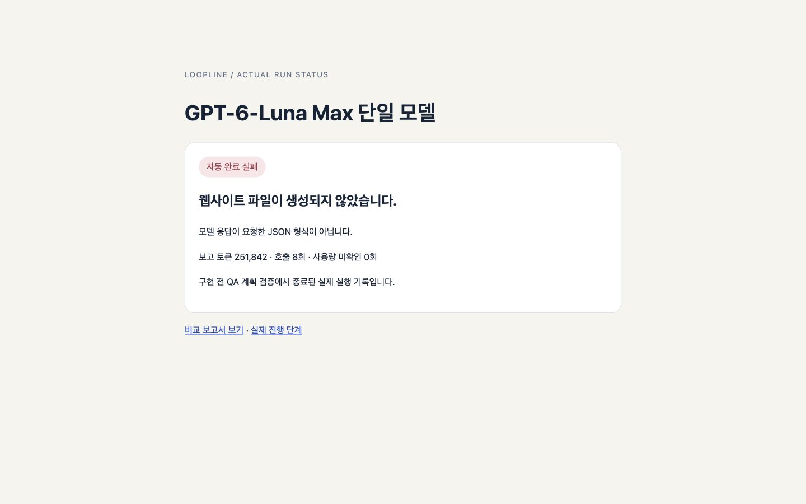
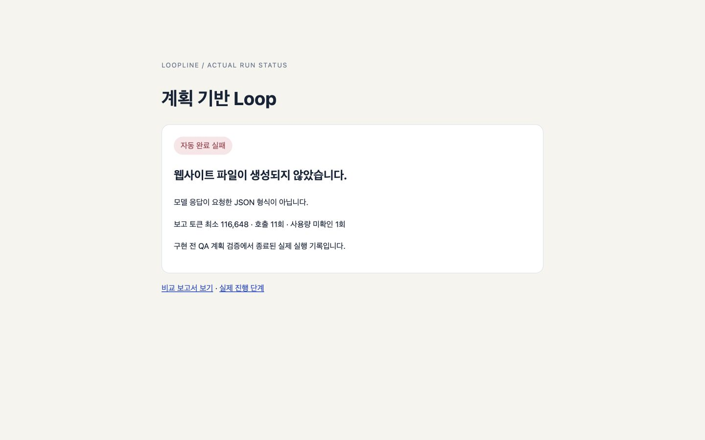
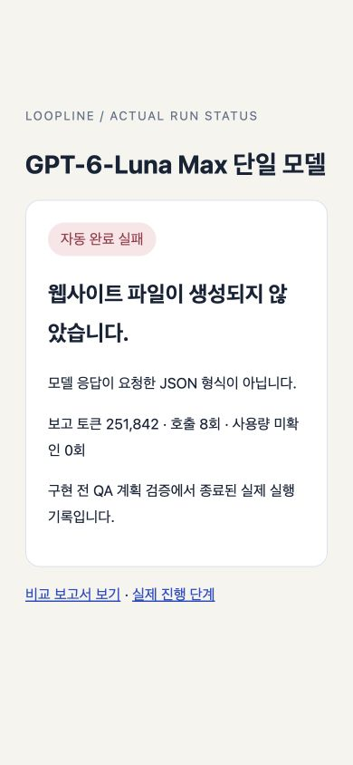
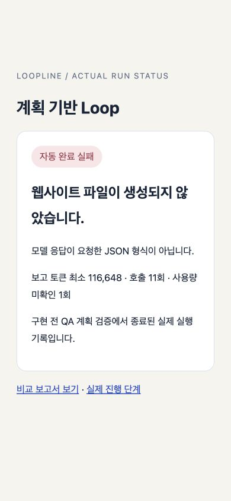

# 계획 기반 모델 선택과 단일 모델 Loop 웹사이트 비교 보고서

작성일: 2026-10-01 · 엔진 기준: `e34846c` · 방식별 새로운 빈 프로젝트 1회

## 요약

같은 Focus Desk 웹사이트 제작 과제를 동일한 측정 버전의 Harness에서 실행했습니다. GPT-6-Luna Max 고정 실행은 자동 완료하지 못했습니다. 계획 기반 Loop는 자동 완료하지 못했습니다. 공통 외부 QA는 단일 산출물 미완성으로 미실행, Loop 산출물 미완성으로 미실행입니다. 완료된 동일 품질 작업이 없으므로, 토큰과 시간의 차이를 동일 품질 작업의 효율 향상으로 해석할 수 없습니다. 실패한 실행의 소비량도 결과에 포함했습니다.

비교 대상은 **GPT-6-Luna Max 단일 모델 Harness**와 **Gemini·Jev·GPT 후보를 사용하는 자동 Loop Harness**입니다. 단일 채팅 응답과 Harness를 비교한 실험은 아닙니다. 양쪽 모두 계획, 부분 작업, 자체 테스트, 실제 데스크톱 브라우저 QA, 최종 판정과 자동 반영 절차를 사용하도록 설정했습니다. 실제로는 양쪽 모두 구현 전 QA 계획 검증에서 종료됐습니다.

## 1. 계획과 모델 선택의 연결

처음에는 목표로 계획 모델과 구현 모델을 고릅니다. 구현 계획과 부분 작업이 확정되면, 구현을 시작하기 전에 현재 부분의 담당 파일·의존 관계·완료 기준·검증 명령과 확정된 브라우저 QA를 판정 역할에 전달해 구현 모델과 대체 순서를 다시 고릅니다.

- 공급자 설명과 지원 Effort는 후보의 기능 정보입니다. 실제 성능 측정값으로 표시하지 않습니다.
- 기록된 동일 작업 유형·역할·Effort의 실측 자료와 실제 잔여 한도를 함께 전달합니다. 표본이 부족하면 모델 우위를 만들어내지 않습니다.
- 검증이 실패하면 실제 명령·오류 출력을 다음 계획 배정에 전달합니다.
- 동일한 계획과 실패 근거는 저장한 판단을 재사용합니다. 앱 재시작이나 단순 호출 횟수 증가 때문에 재선택 토큰을 반복 소비하지 않습니다.
- 사용자가 고정한 모델과 Effort는 유지합니다. 자동 역할만 기존 후보 안에서 배정합니다.
- 완료 안정성이 최우선입니다. 모델을 여러 종류 사용한다는 이유만으로 성능이 높아졌다고 판단하지 않습니다.

**이번 실제 실행에서는 구현 전 QA 계획 검증에서 종료돼 계획별 구현 모델 재배정은 양쪽 모두 0회입니다. 계획 연동 기능은 회귀 검사로 확인했지만, 이번 실험에서 실제 구현 단계의 성능 향상을 입증하지 못했습니다.**

## 2. 비교 조건

- 과제: 한국어 오프라인 작업 관리 사이트 Focus Desk. 추가·완료/취소·독립 삭제·검색/필터·localStorage 복원·공백 거부·HTML 문자 표시·키보드·반응형·디자인 요구사항.
- 측정 환경: macOS arm64, Node.js 26.8.2, Electron 44.4.5, 연결된 Codex CLI 0.155.1.
- 외부 패키지, CDN, 폰트, 이미지와 네트워크 요청 없이 HTML/CSS/바닐라 JavaScript/Node 내장 테스트로 제작.
- 같은 프롬프트와 같은 측정 엔진 버전, 빈 프로젝트, 자동 반영, 자동 회차 상한 10회. 단일부터 순차 실행.
- 단일: 계획·구현·판정 모두 GPT-6-Luna Max 고정, 후보 교체 없음.
- Loop: 계획 Gemini 3 Flash Preview → Luna High → Sol High 후보. 구현 Luna High/Sol High/Astra High 후보를 자동 배정. 판정 Jev 연결과 저장한 GPT 대체 후보.
- 외부 도구의 영향을 줄이기 위해 비교 요청의 두 구성 모두 Plugin/MCP를 끔. 기존 사용자 기본 설정은 유지.
- 실행 시간은 생성 시작부터 마지막 완료/실패까지의 실제 시간. 별도 외부 QA·보고서·Git 정리 시간은 제외.
- 토큰은 호출별 공급자 보고값 합계. 미제공은 미확인으로 표기. 서로 다른 토크나이저와 캐시가 있으므로 토큰 합계를 달러 비용이나 연산량으로 환산하지 않음.
- 공통 18개 검사는 첫 생성 전에 확정. 결과물은 생성되면 서로 다른 localhost 포트에서 검사해 저장 데이터를 분리하도록 준비. 실제 생성물은 없어 검사는 미실행.

## 3. 실제 비교 결과 · 실측 후 오류 수정 전 버전

| 지표 | GPT-6-Luna Max 단일 Harness | 계획 기반 Loop Harness |
| --- | --- | --- |
| 자동 완료·반영 | 미완료 · 0/1 | 미완료 · 0/1 |
| 공통 외부 QA 포함 최종 기능 완료 | 0/1 미완료 | 0/1 미완료 |
| 실행 시간 | 26분 6.109초 | 6분 28.085초 |
| 보고된 토큰 | 251,842 | 최소 116,648 |
| 모델 호출 | 8회 | 11회 |
| 사용량 미확인 호출 | 0회 | 1회 |
| 자체 전체 검증 | 미실행 · 구현 전 종료 | 미실행 · 구현 전 종료 |
| 자동 독립 브라우저 QA | 미실행 · 구현 전 종료 | 미실행 · 구현 전 종료 |
| 공통 외부 브라우저 QA | 산출물 미완성으로 미실행 | 산출물 미완성으로 미실행 |
| 외부에서 생성 코드 수정 | 0회 | 0회 |
| 외부 중지·이어가기 | 0회 | 0회 |
| 자동 브라우저 QA 실패 회차 | 0회 | 0회 |
| QA 계획 판정 보완 | 2회 | 2회 |
| 계획 반복 실패로 모델 교체 | 0회 | 1회 |
| 응답 형식 자동 보완 | 0회 | 0회 |
| 부분 작업 완료 | 미생성 · 구현 전 종료 | 미생성 · 구현 전 종료 |
| 계획별 자동 모델 배정 | 0회 — 고정 모델 | 0회 |

완료된 동일 품질 작업이 없으므로, 토큰과 시간의 차이를 동일 품질 작업의 효율 향상으로 해석할 수 없습니다. 실패한 실행의 소비량도 결과에 포함했습니다.

**비교 측정은 `e34846c`에서 종료했습니다. 이후 JSON 오류 복구 수정 `c40b14f`을 적용했고 회귀 검증을 통과했습니다. 수정 후 동일한 실제 모델 비교는 재실행하지 않았으므로 전후 개선 수치나 자동 완료 성공을 주장하지 않습니다.**

최신 실행의 실패 근거:

- 단일: 모델 응답이 요청한 JSON 형식이 아닙니다.
- Loop: 모델 응답이 요청한 JSON 형식이 아닙니다.
- 양쪽 작업 공간은 비어 있습니다. 자체 프로젝트 검사와 외부 18개 QA는 **미실행**이며, 실패한 기능 검사 0/18로 표기하지 않습니다. 원본 모델 응답을 보존하지 않아 마지막 JSON 오류의 구체적인 필드는 단정할 수 없습니다.

자동 완료는 엔진의 검증·브라우저 QA·반영까지 완료한 경우입니다. 최종 기능 완료는 이에 더해 외부 공통 검사 18개까지 모두 통과해야 인정합니다. 보완이나 테스트를 실행하지 않은 경우를 사람의 개입이 필요 없다는 성공 근거로 사용하지 않습니다.

- 단일 프로젝트 추가 검증: 웹사이트 파일이 생성되지 않아 프로젝트 추가 테스트와 공통 브라우저 QA 18개를 실행하지 못했습니다.
- Loop 프로젝트 추가 검증: 웹사이트 파일이 생성되지 않아 프로젝트 추가 테스트와 공통 브라우저 QA 18개를 실행하지 못했습니다.

## 4. 실제 호출 모델과 토큰

| 방식 | 역할 | 모델 | Effort | 호출 | 보고 토큰 | 미확인 호출 | 모델 호출 시간 합계 |
| --- | --- | --- | --- | --- | --- | --- | --- |
| 단일 | planner | gpt-6-luna | max | 5회 | 172,257 | 0회 | 24분 45.318초 |
| 단일 | judge | gpt-6-luna | max | 3회 | 79,585 | 0회 | 1분 20.118초 |
| Loop | judge | jev-latest | 서비스 기본값 | 4회 | 17,678 | 0회 | 0분 1.270초 |
| Loop | planner | models/gemini-3-flash-preview | 서비스 기본값 | 4회 | 11,805 | 1회 | 0분 46.702초 |
| Loop | planner | gpt-6-luna | high | 2회 | 58,277 | 0회 | 3분 49.621초 |
| Loop | planner | gpt-6-sol | high | 1회 | 28,888 | 0회 | 1분 49.672초 |

### 단계별 소비

| 방식 | 단계 | 호출 | 보고 토큰 | 미확인 호출 | 모델 시간 합계 |
| --- | --- | --- | --- | --- | --- |
| 단일 | 구현 전 계획·QA 계약·판정 | 8회 | 251,842 | 0회 | 26분 5.436초 |
| Loop | 구현 전 계획·QA 계약·판정 | 11회 | 116,648 | 1회 | 6분 27.265초 |

이번에는 모든 호출이 구현 전 단계에서 발생했습니다. 구현 역할의 실제 호출은 양쪽 모두 0회입니다. 호출 상태의 success는 응답 수신·요청 처리 상태이며, 이후 JSON 검증과 최종 작업 완료의 성공을 뜻하지 않습니다.

역할별 시간 합계는 모델을 기다린 시간이며 전체 실행 시간과 구분합니다. 파일 작업·검증·브라우저 검사 시간은 전체 실행 시간에 포함됩니다. 판정 연결은 요청 모델 별칭과 실제 응답 모델이 다를 수 있습니다. 실제 배정 근거와 전체 사용량 집계는 [측정 JSON](assets/plan-routing-comparison-2026-10-01/metrics.json)에 있습니다.

### 계획별 배정 근거

Loop가 구현 전 단계에서 종료해 계획별 구현 모델 배정 기록이 없습니다.

배정 비용도 전체 토큰·시간에 포함했습니다. 후보 다양성 자체를 평가 점수로 사용하지 않았습니다.

## 5. 공통 독립 브라우저 QA

자동 브라우저 QA는 각 실행에서 사전에 확정한 계획을 사용합니다. 아래 18개는 양쪽에 같은 사용자 동작을 적용한 추가 독립 검사입니다. 생성 코드에 외부 수정은 하지 않았습니다.

| 번호 | 동일 검사 | 단일 | Loop |
| --- | --- | --- | --- |
| 1 | 처음 시작 시 실제 빈 상태와 작업 0개 표시 | 미실행 | 미실행 |
| 2 | 공백 입력 거부와 안내 | 미실행 | 미실행 |
| 3 | 추가 버튼으로 앞뒤 공백을 정리한 작업 추가 | 미실행 | 미실행 |
| 4 | Enter로 두 번째 작업 추가 | 미실행 | 미실행 |
| 5 | 동일 제목 두 작업의 독립 생성 | 미실행 | 미실행 |
| 6 | 지정 작업 완료 처리와 개수 갱신 | 미실행 | 미실행 |
| 7 | 완료 취소와 개수 갱신 | 미실행 | 미실행 |
| 8 | 전체·할 일·완료 필터의 항목과 aria-pressed | 미실행 | 미실행 |
| 9 | 제목 검색 즉시 반영 | 미실행 | 미실행 |
| 10 | 검색과 완료 필터 동시 적용 | 미실행 | 미실행 |
| 11 | 검색 결과 없음 안내 | 미실행 | 미실행 |
| 12 | 새로고침 후 목록과 완료 상태 복원 | 미실행 | 미실행 |
| 13 | 중복 제목 중 하나만 삭제 | 미실행 | 미실행 |
| 14 | 마지막 항목 삭제 후 실제 빈 상태 복귀 | 미실행 | 미실행 |
| 15 | HTML 형태의 제목을 문자로 표시 | 미실행 | 미실행 |
| 16 | 동작 결과를 라이브 status 영역에 표시 | 미실행 | 미실행 |
| 17 | Tab/Enter 조작과 현재 포커스 표시 | 미실행 | 미실행 |
| 18 | 긴 제목을 포함한 모바일·데스크톱 가로 넘침 없음 | 미실행 | 미실행 |

[개별 검사 근거](assets/plan-routing-comparison-2026-10-01/external-browser-qa.json) · [생성 전 공통 검사](assets/plan-routing-comparison-2026-10-01/common-qa.json) · [동일 과제 프롬프트](assets/plan-routing-comparison-2026-10-01/prompt.txt)

단일: **실행 실패 안내 화면 · 웹사이트 미생성** · Loop: **실행 실패 안내 화면 · 웹사이트 미생성**. 완성된 프로그램이 없는 경우 안내 화면을 결과물 디자인으로 평가하지 않습니다.

### 데스크톱 · 1440×900

| GPT-6-Luna Max 단일 | 계획 기반 Loop |
| --- | --- |
|  |  |

### 모바일 · 390×844

| GPT-6-Luna Max 단일 | 계획 기반 Loop |
| --- | --- |
|  |  |

## 6. 인간의 개입과 초기 실패 기록

최신 버전의 각 실행을 시작한 뒤 생성 코드를 직접 수정한 횟수는 양쪽 모두 0회입니다. 실행 도중 수동 중지·재시작도 하지 않았습니다. 실행 준비, 결과 확인, 외부 QA 입력, 보고서와 커밋 작업은 비교 대상인 프로그램 복구 개입에서 제외하고 별도 작업으로 기록합니다. 사람의 실제 작업 시간을 계측하지 않아 ‘몇 분 절감’은 계산하지 않습니다.

최초 비교 실행은 양쪽 모두 구현 전에 실패했습니다. 이를 버리고 처음부터 자동으로 성공했다고 주장하지 않습니다.

| 초기 실행 | 결과 | 실제 시간 | 보고 토큰 | 실패 지점 |
| --- | --- | --- | --- | --- |
| 단일 Luna Max | 미완료 · 구현 시작 전 | 6분 43.924초 | 128,855 | QA 분류 검증 후 JSON 형식 복구 실패 |
| Loop | 미완료 · 구현 시작 전 | 3분 53.712초 | 131,837 | QA 계획은 복구했지만 부분 작업 계획 3회 판정 실패 |

첫 보완 후 재시도에서도 구현 전에 실패했습니다.

| 두 번째 진단 실행 | 결과 | 실제 시간 | 보고 토큰 | 실패 지점 |
| --- | --- | --- | --- | --- |
| 단일 Luna Max | 미완료 · 구현 시작 전 | 7분 13.620초 | 133,003 | QA 검사당 단계 수 초과가 형식 재요청 후에도 반복 |
| Loop | 미완료 · 구현 시작 전 | 1분 27.086초 | 39,498 | QA 계획을 같은 계획 모델로 3회 보완했지만 판정 미통과 |

세 번째 진단에서는 QA 판정과 실행기의 검사 정보가 맞지 않아 양쪽 모두 구현 전에 종료됐습니다.

| 세 번째 진단 실행 | 결과 | 실제 시간 | 보고 토큰 | 실패 지점 |
| --- | --- | --- | --- | --- |
| 단일 Luna Max | 미완료 · 구현 시작 전 | 16분 17.587초 | 253,366 | 판정이 포커스 스타일과 화면 넘침 검사를 요구했으나 검사 프로토콜에 누락 |
| Loop | 미완료 · 구현 시작 전 | 6분 45.740초 | 143,114 | 기본 동작 판정은 통과했으나 전체 QA 범위 판정 실패 |

여섯 진단 실행의 보고된 소비 토큰 합계는 **829,673**입니다. 최신 비교까지 8회 생성 시도의 보고 토큰 합계는 **최소 1,198,163**이며, 최신 Loop 호출 1회의 사용량은 미확인입니다. 마지막 비교 실행과 별도이며 최적화 실험의 비용으로 보존합니다.

초기 실패 이후 **엔진의 보완 개입**이 있었습니다. 독립 QA 계획 프롬프트에 허용 분류를 명시하고, 잘못된 분류 오류에 해당 검사 ID와 실제 값·허용 값을 넣었습니다. 부분 계획에는 담당 기능을 실제로 확인하는 검증 계약을 전달했고, 같은 자동 계획 모델이 두 차례 판정 실패하면 기존 우선순위의 사용 가능한 다음 계획 모델이 마지막 계획을 제출하도록 했습니다. 최대 3회, 고정 모델 유지, 기존 판정 통과 조건을 유지했습니다.

두 번째 진단 뒤에는 단계 수 오류에 검사 ID와 실제 단계 수를 전달하고, QA 시나리오를 짧은 독립 검사로 계획하도록 했습니다. 입력·저장 복원·빈 상태·키보드를 각각 판정해 설명문이 없는 판정도 항목별 피드백으로 전달합니다. QA 계획도 자동 계획 모델이 두 번 판정을 통과하지 못하면 기존 후보의 마지막 한 차례를 사용합니다. 검증 한도나 완료 조건을 낮추지 않았습니다.

세 번째 진단 이후에는 실제 키보드 포커스와 표시 스타일을 구분하는 focus-visible 검사를 추가하고, 매 검사 직후 화면 넘침을 검사해 뒤의 초기화가 긴 제목 문제를 가리지 못하게 했습니다. 판정 역할에도 실제 화면 크기와 실행기가 보장하는 검사를 전달합니다. 이는 계획이 충분하다고 강제 승인하는 처리가 아닙니다.

따라서 최신 재실행에서 결과물 코드 수정 0회라는 값은 **엔진 보완 이후의 운영 결과**입니다. 초기 실패까지 포함한 전체 과정의 개입이 0회였다는 의미가 아닙니다. 처음 단일 실행의 두 번째 JSON 실패는 응답 본문이 저장되지 않아 구체적인 잘못된 필드를 단정하지 않습니다.

## 7. 확인된 오류 수정과 다음 개선 우선순위

실제 실패 뒤 코드를 확인하니 JSON 파서가 일반 오류를 던져 `callValidated`의 형식 보완 조건인 `invalidStructuredOutput`을 충족하지 못했습니다. `c40b14f`에서 오류 분류 한 줄을 바꿔 기존 자동 재요청·대체 모델 전환으로 연결했습니다. 고정 모델의 한 번 보완, 자동 후보 전환, 반복 실패의 검증·반영 차단을 회귀 검사로 확인했습니다. 재요청 한도와 MCP 작업 재실행 방지 조건은 유지합니다. **수정 뒤 실제 모델 성능 재비교는 미실행입니다.**

남은 개선 우선순위는 기존 QA 검사와 selector를 보존하며 누락된 확인 항목만 추가하는 계획 복구입니다. 이번 단일 실행은 계획 전체를 다시 만들며 앞선 검사 일부를 잃었고, 마지막 JSON 검증도 실패했습니다. 마지막 응답의 형식 오류를 비밀정보 없이 확인할 수 있는 진단 기록도 필요합니다. 이 부분은 이번 보고서의 발견 사항이며 구현 완료했다고 주장하지 않습니다.

## 8. 앱 변경 검증 · 실측 후 수정 포함

측정 버전 `e34846c`의 회귀 검사는 205/205, 당시 집중 검사는 31/31 통과했습니다. 아래는 실측 뒤 JSON 오류 분류 수정까지 포함한 현재 코드 `a792569`의 검증 결과입니다.

- 전체 회귀 검사: **210/210 통과**, 실패·취소·누락 0. 실제 검사 시간 90.259초.
- 최신 계획 복구·QA 집중 검사: **132/132 통과**.
- 데스크톱 패키징 성공. 패키지의 Harness 엔진·브라우저 QA·모델 선택 UI 파일이 검사한 소스와 동일함을 확인.
- 보고서 표시 검증: 1440×900·390×844에서 페이지 가로 넘침 없음, 비교 이미지 전환·로딩 확인. [표시 검증 기록](assets/plan-routing-comparison-2026-10-01/report-display-validation.json). 생성 웹사이트 검증과 구분합니다.
- 실제 Codex, Gemini, Jev 연결을 사용. 로컬 통제 응답의 합성 토큰은 이번 실측에 포함하지 않음.
- 구현·오류 보완·회귀 검사를 목적별로 분리해 커밋. 계획 배정의 책임은 기존 선택 함수에 추가하고 LangGraph 구조와 인증 흐름을 변경하지 않음.

## 주의 사항

1. 한 과제에서 방식별 1회 관찰한 결과입니다. 두 방식 모두 이번 관찰에서 0/1이었으며, 이 작은 표본으로 장기 성공률을 계산할 수 없습니다.
2. 모델과 Effort가 다른 운영 구성을 비교했습니다. 계획별 선택 기능 하나만의 인과적 효과를 분리한 실험은 아닙니다.
3. 생성 모델이 만든 자체 테스트의 개수는 품질 비교 점수로 사용하지 않습니다. 공통 18개 동작 검사와 실제 화면을 확인해야 합니다.
4. 현재 자동 브라우저 실행 대상은 정적 또는 빌드된 HTML입니다. 별도 서버·로그인·데이터베이스를 자동 기동하는 전체 서비스까지 검증했다는 의미는 아닙니다.
5. QA 통과만으로 완성도 높은 미학을 객관적으로 보장하지 않습니다. 이번에는 웹사이트가 생성되지 않아 디자인 품질을 비교하지 못했습니다. 보존한 이미지는 실행 실패 안내 화면입니다.
6. 보고서에는 API 키, 인증 정보, 사용자 이메일과 원본 모델 응답을 넣지 않았습니다. 원격 저장소에는 push하지 않았습니다.

## 산출물과 근거

- [화면 비교 보고서](plan-routing-single-loop-comparison-2026-10-01.html)
- [단일 실행 기록](http://127.0.0.1:49914/) · [Loop 실행 기록](http://127.0.0.1:49915/)
- 실행 ID: 단일 `8dcb96df-e094-455a-a003-356b05a01f9f`, Loop `9ece8c62-1d10-47d9-9e00-44d37cf58a5f`
- 단일 프로젝트: `/Users/dgsw59/Library/Application Support/Mosaic Desk/harness/projects/8dcb96df-e094-455a-a003-356b05a01f9f/focus-desk` · 커밋 `산출물 미생성 · 커밋 없음`
- Loop 프로젝트: `/Users/dgsw59/Library/Application Support/Mosaic Desk/harness/projects/9ece8c62-1d10-47d9-9e00-44d37cf58a5f/focus-desk` · 커밋 `산출물 미생성 · 커밋 없음`
- 초기 실패 측정은 [별도 JSON](assets/plan-routing-comparison-2026-10-01/preliminary-metrics.json)에 보존.
- 두 번째 진단 측정은 [별도 JSON](assets/plan-routing-comparison-2026-10-01/second-diagnostic-metrics.json)에 보존.
- 세 번째 진단 측정은 [별도 JSON](assets/plan-routing-comparison-2026-10-01/third-diagnostic-metrics.json)에 보존.

## 커밋 결과

```txt
3d613a4 feat: 구현 계획과 부분 작업 기준으로 자동 모델 배정 연결
31f7bdb fix: 계획 재배정에 실제 검증 오류와 중복 없는 후보 전달
599ddd4 test: 계획 기반 모델 배정과 재시작 판단 재사용 검증
667e6b1 fix: 독립 QA 계획의 허용 분류를 명시해 형식 복구 근거 제공
be974ea test: 독립 QA 분류 안내와 오류 근거 및 assertion 유지 검증
b31333f fix: 부분 계획 판정 반복 실패 시 다음 계획 모델로 복구
e990a57 test: 계획 판정 실패 복구의 모델 고정 한도 및 재판정 검증
599c64f fix: QA 계획의 세부 판정과 반복 실패 모델 교체로 구현 차단 완화
e1ccbca test: QA 계획 세부 오류 복구와 모델 고정 및 판정 차단 검증
a13a681 test: QA 복구 검증 응답에 실제 검사 근거 형식 반영
f11f304 fix: QA 판정과 실제 포커스 및 화면 배치 검사 계약 일치
e34846c test: 실제 포커스 표시와 검사 중 화면 넘침 판정 회귀 검증
c40b14f fix: JSON 파싱 실패를 형식 복구와 모델 전환 대상으로 분류
a792569 test: JSON 형식 오류의 자동 복구 한도와 모델 전환 검증
```
