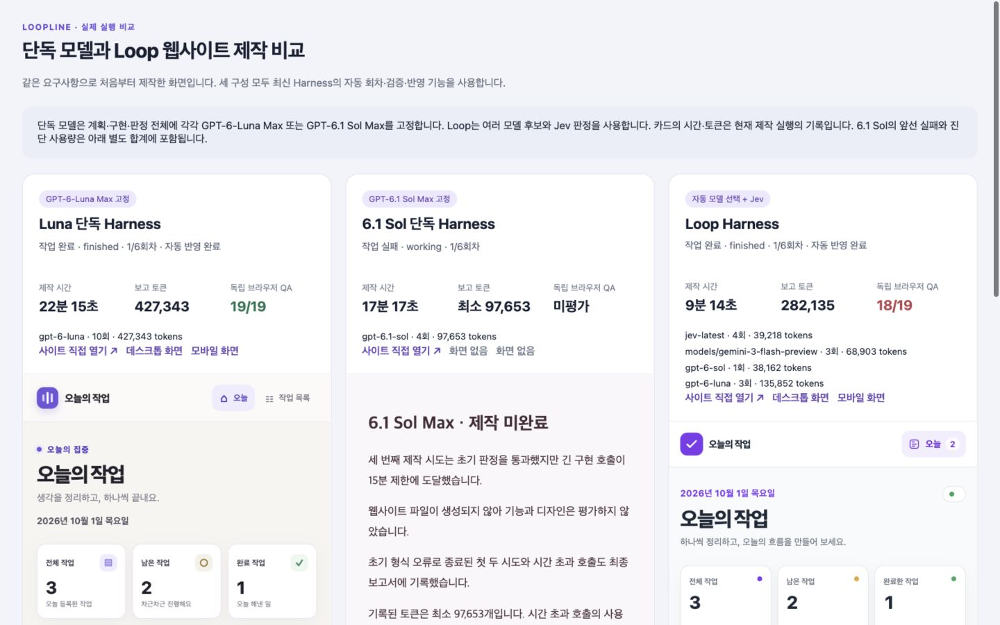
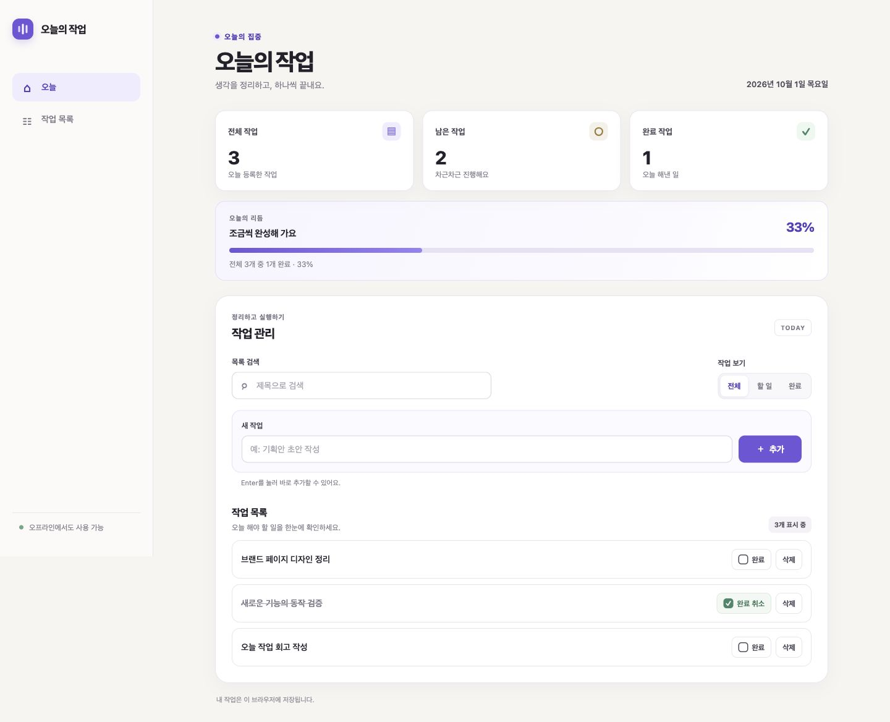
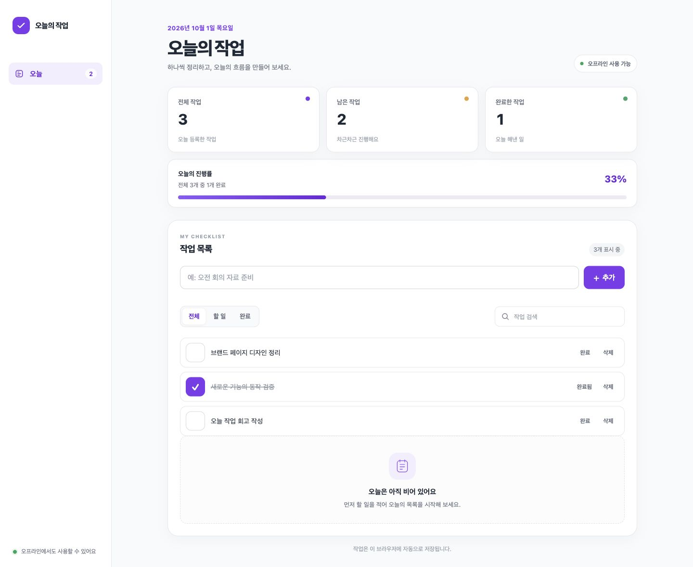
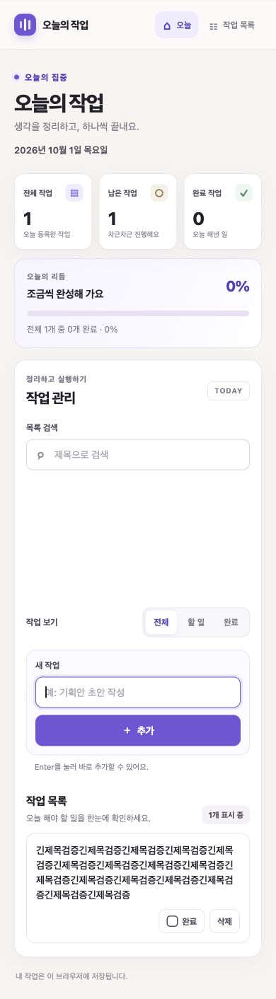
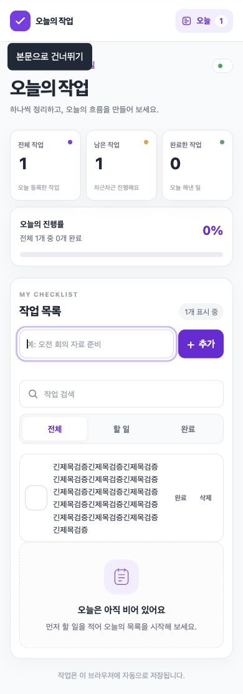

# 웹사이트 제작 실제 비교 보고서: Luna Max · GPT-6.1 Sol Max · Loop Harness

작성일: 2026-10-01

실험 대상: 한국어 오프라인 작업 관리 웹사이트 **오늘의 작업**

실행 엔진: Loopline **fbe049f**의 Harness·LangGraph 흐름

## 요약

같은 요구사항으로 세 구성을 새로 실행했습니다. Luna Max 단독은 22분 15.338초, 427,343토큰으로 검증과 자동 반영을 마쳤습니다. Loop는 9분 14.191초, 282,135토큰으로 마쳤습니다. Loop는 이번 실행에서 Luna보다 시간이 58.5%, 기록 토큰이 34.0% 적었습니다.

GPT-6.1 Sol Max는 첫 두 시도에서 초기 폴더 판정 JSON 형식 오류로 종료됐습니다. 별도 진단 이후 **동일한 제작 프롬프트를 쓴 세 번째 시도**는 미완료 상태로 끝났습니다. 초기 판정을 통과했으나 긴 구현 호출이 15분 제한에 도달했습니다. 세 번째 시도의 시간은 17분 17.478초, 기록 토큰은 **최소 97,653개**입니다. 시간 초과 호출 1회의 토큰은 제공되지 않았습니다. 실패 시도와 진단 사용량을 별도로 포함해 기록했습니다.

독립 브라우저 검증은 Luna 19/19, 6.1 Sol 산출물 없음, Loop 18/19입니다. **Loop는 작업이 있는 화면에서 빈 상태 안내를 함께 노출하는 결함이 남았습니다.** Luna는 기능 검사에 통과했지만 모바일 검색 영역의 과도한 여백이 보입니다. 따라서 이번 결과는 Loop의 시간·토큰 절감 근거이며, 화면 품질 우위의 근거는 아닙니다.

## 비교 조건과 측정 범위

- 세 구성에 동일한 [제작 프롬프트](assets/website-three-way-2026-10-01/prompt.txt)를 사용했습니다. 빈 프로젝트에서 HTML·CSS·vanilla JavaScript로 제작하고, 외부 의존성·CDN 없이 동작하도록 요구했습니다.
- 단독 구성도 같은 Harness에서 계획·구현·판정을 한 모델로 고정했습니다. 일반 채팅의 한 번 응답과 비교하는 실험은 아닙니다.
- 자동 회차 모드는 초기 6회, 확장 상한 10회입니다. 완료된 실행은 실제 1회차에서 끝났습니다. 검증 명령은 사전에 지정하지 않고 모델이 코드에 맞게 제안하도록 했습니다.
- 우선순위는 품질 → 추론 → 토큰 효율 → 속도이며, 검증 후 자동 반영을 켰습니다. 사용자 승인 대기로 중단된 실행은 없습니다.
- Luna는 계획·구현·판정 모두 gpt-6-luna / max, 6.1 Sol은 모두 gpt-6.1-sol / max입니다.
- Loop의 기본 계획은 Gemini 3 Flash Preview, 기본 구현은 GPT-6-Sol Max, 판정·선택은 Jev입니다. 구현 대체 순서는 Luna Max → Astra high입니다. 실제로 Sol의 형식 오류 뒤 Luna로 자동 전환했습니다.
- MCP 도구는 선택하지 않았습니다. 이번 측정은 Paper·Figma 호출 성능을 평가하지 않습니다.
- 제작 시간은 실행 생성부터 최종 상태 저장까지의 벽시계 시간입니다. 독립 브라우저 QA, 진단 준비, 보고서 작성 시간은 제작 시간과 분리했습니다. 웹사이트 자체의 CPU·메모리·Lighthouse 성능은 측정하지 않았습니다.

### 실행 환경 차이

Luna·Loop는 실행 중인 패키지 앱의 Codex CLI 0.155.1을 사용했습니다. 그 연결에는 6.1 Sol이 없어, 데스크톱에 설치된 공식 CLI 0.159.0으로 별도 백엔드를 실행했습니다. 해당 모델 목록에서 gpt-6.1-sol과 max 지원을 확인했습니다.

기존 패키지와 작업 저장소의 server.mjs·harness-engine.mjs SHA-256은 각각 일치했습니다. 6.1 Sol의 세 번째 시도는 같은 엔진에 **최종 역할 응답을 로컬 진단 파일로 기록하는 코드만 추가한 별도 백엔드**에서 진행했습니다. 응답 프롬프트, 판정 기준, 파싱, 모델 선택 로직은 바꾸지 않았습니다. CLI 버전·백엔드 디렉터리·캐시 상태의 차이가 있으므로 모델 간 엄밀한 통제 실험으로 보지는 않습니다.

## 실행 결과

아래 표의 6.1 Sol 시간·토큰은 세 번째 실행만의 값입니다. 첫 실패와 재시도 총량은 다음 표에 별도로 제시합니다.

| 비교 항목 | GPT-6-Luna Max 단독 | GPT-6.1 Sol Max 단독, 세 번째 실행 | Loop Harness |
| --- | ---: | ---: | ---: |
| 검증·자동 반영 | 완료·검증·자동 반영 | 미완료 | 완료·검증·자동 반영 |
| 최종 실행 시간 | 22분 15.338초 | 17분 17.478초 | 9분 14.191초 |
| 기록 토큰 | 427,343 | 최소 97,653 | 282,135 |
| 사용량이 기록된 모델 호출 | 10회 | 4회 + 시간 초과 1회 미기록 | 11회 |
| 자체 테스트의 TAP 보고 수 | 8개 통과 | 미실행 | 10개 통과 |
| 사전 공통 브라우저 검사 18개 | 18/18 | 미평가 | 18/18 |
| 추가 빈 상태 검사까지 19개 | 19/19 | 산출물 없음 | 18/19 |
| 생성 코드의 외부 직접 수정 | 0회 | 0회 | 0회 |

자체 테스트는 각 모델이 만든 검사이므로 개수로 모델 성능을 비교하지 않습니다. Loop의 10개에는 부모 테스트 1개와 개별 검사 9개가 포함되어 있습니다. 공통 브라우저 항목을 동일하게 적용한 결과가 기능 비교의 기준입니다.

### 최초 시도와 재시도를 포함한 완료

| 지표 | Luna 단독 | 6.1 Sol 단독 | Loop |
| --- | ---: | ---: | ---: |
| 최초 시도에서 검증·자동 반영 | 1/1 | 0/1 | 1/1 |
| 모든 제작 시도 중 검증·자동 반영 | 1/1 | 0/3 | 1/1 |
| 해당 산출물의 독립 QA 19개도 모두 통과한 제작 시도 | 1/1 | 0/3 | 0/1 |
| 제작 시도의 시간 합계 | 22분 15.338초 | 18분 10.095초 | 9분 14.191초 |
| 제작 시도의 기록 토큰 합계 | 427,343 | 최소 191,350 | 282,135 |

위 분수는 이번 한 과제에서의 관측 횟수입니다. 장기 성공률 또는 모델의 일반적인 성공 확률로 해석하지 않습니다. Loop는 Harness가 완료로 판정했지만 독립 화면 QA를 모두 통과하지 못했습니다. 검증·반영 완료와 품질 완료를 구분해야 합니다.

## GPT-6.1 Sol 초기 실패·진단 기록

| 구분 | 결과 | 시간 | 기록 토큰 | 호출 수 |
| --- | --- | ---: | ---: | ---: |
| 제작 시도 1 | 초기 폴더 판정 JSON 오류, 프로젝트 생성 전 종료 | 0분 24.393초 | 46,865 | 2 |
| 제작 시도 2 | 초기 폴더 판정 JSON 오류, 프로젝트 생성 전 종료 | 0분 28.224초 | 46,832 | 2 |
| 별도 판정 응답 진단 | 올바른 JSON 응답 확인, 웹사이트 제작 제외 | 0분 11.696초 | 21,213 | 1 |
| 제작 시도 3, 응답 기록 백엔드 | 구현 호출 시간 초과, 파일 미생성 | 17분 17.478초 | 최소 97,653 | 4회 기록 + 1회 시간 초과 |

첫 두 시도의 실제 응답 본문은 보존되지 않아, 형식 오류의 원인을 특정 토큰이나 전송 처리로 확정할 수 없습니다. 별도 진단과 세 번째 시도에서는 유효한 초기 판정 JSON을 확인했습니다. **오류를 고쳤다고 주장하지 않으며, 초기 형식 응답의 재현성 문제는 남은 확인 항목입니다.**

제작 시도와 별도 진단을 모두 더한 6.1 Sol의 모델 실행 기록은 **최소 212,563토큰, 사용량이 기록된 9회 + 사용량 미제공 1회, 18분 21.791초**입니다. 이 시간 합계에는 실행 사이의 진단 준비·대기·보고서 작성 공수가 포함되지 않습니다. 파일 생성까지 가지 못했으므로 6.1 Sol의 웹사이트 기능·디자인 품질은 평가할 수 없습니다.

## 모델별 토큰과 자동 교체

| 구성 | 실제 호출 모델 | 호출 수 | 기록 토큰 |
| --- | --- | ---: | ---: |
| GPT-6-Luna Max 단독 | gpt-6-luna | 10 | 427,343 |
| GPT-6.1 Sol Max 단독 | gpt-6.1-sol | 4 | 97,653 |
| Loop Harness | jev-latest → jev-1.13.0 | 4 | 39,218 |
| Loop Harness | models/gemini-3-flash-preview | 3 | 68,903 |
| Loop Harness | gpt-6-sol | 1 | 38,162 |
| Loop Harness | gpt-6-luna | 3 | 135,852 |

Loop에서는 기본 구현 모델 Sol의 응답이 요청된 작업 JSON을 따르지 않아 실패했습니다. 저장된 대체 순서에 따라 Luna로 자동 전환했고, 구현·검증·Jev 판정·반영까지 이어졌습니다. 이 Sol 실패 호출의 토큰도 Loop 합계에 포함되어 있습니다. 사람이 모델을 중간에 바꾸거나 생성 파일을 수정하지 않았습니다.

Jev의 최종 답변은 목표 충족 pass 39%, 검증 pass 85%, 시각 설계 pass 100%였습니다. 엔진은 질문별 선택이 pass인지와 확률 값의 일관성을 확인합니다. 이 값은 Jev가 반환한 선택 확률이며, 관측 성공률·사용자 만족도·실제 시각 품질 점수가 아닙니다. 특히 시각 설계 pass 100%에도 독립 화면 검사에서 빈 상태 결함이 발견됐습니다.

### 사용량 대조

| 구성, 최종 제작 실행 | 입력 | 출력 | 입력에 포함된 캐시 | 출력에 포함된 추론 | Harness 합계와 사용량 로그 |
| --- | ---: | ---: | ---: | ---: | --- |
| GPT-6-Luna Max 단독 | 377,012 | 50,331 | 99,072 | 22,988 | 일치 |
| GPT-6.1 Sol Max 단독 | 93,994 | 3,659 | 0 | 2,612 | 일치 |
| Loop Harness | 241,084 | 37,592 | 48,384 (부분 제공) | 11,336 (부분 제공) | 일치 |

전체 토큰은 제공자가 보고한 totalTokens를 사용했습니다. Codex와 Jev는 입력·출력 합계와 전체가 일치하지만 Gemini는 3회 합계에서 **3,459개 차이**가 있습니다. 현재 로그에 그 차이의 분류가 없으므로 추론·캐시 등으로 임의 배정하지 않았습니다. Loop의 캐시·추론 세부 값은 Codex의 4회 호출에서 확인한 부분 합계이며 Jev·Gemini 7회는 해당 세부 값을 제공하지 않았습니다.

Codex의 캐시 입력은 입력의 일부, 추론 출력은 출력의 일부이므로 합계에 다시 더하지 않았습니다. Luna와 Loop는 역할 호출 수와 전체 사용량 기록 수가 일치했습니다. 6.1 Sol 세 번째 실행은 역할 호출 5회 중 4회만 기록됐고, 시간 초과 1회가 누락됐습니다. 로그 합계 일치는 기록된 호출 사이의 대조 결과이며 누락이 없다는 뜻으로 확대하지 않습니다. 제공자 청구 내역과 대조한 달러 금액은 없습니다. Jev·Gemini API와 Codex 계정의 토큰을 같은 금액으로 환산하지 않았습니다.

## 독립 브라우저 QA

모델이 만든 코드에 직접 수정 없이 검증했습니다. 1–18은 실행 전에 정한 공통 항목이고, 19는 화면 확인에서 발견한 빈 상태 문제를 검사하도록 추가한 항목입니다. 두 생성 산출물에 같은 항목을 적용했고, 6.1 Sol은 파일이 없어 미평가로 남겼습니다.

| 번호 | 공통 검증 항목 | Luna | 6.1 Sol | Loop |
| --- | --- | --- | --- | --- |
| 1 | 초기 제목·날짜·빈 작업 목록 | 통과 | 미평가 | 통과 |
| 2 | 작업 추가와 제목 앞뒤 공백 정리 | 통과 | 미평가 | 통과 |
| 3 | 공백 입력 거부와 접근성 안내 | 통과 | 미평가 | 통과 |
| 4 | Enter로 작업 추가 | 통과 | 미평가 | 통과 |
| 5 | 완료 처리와 완료 취소 | 통과 | 미평가 | 통과 |
| 6 | 전체·할 일·완료 필터와 선택 상태 | 통과 | 미평가 | 통과 |
| 7 | 제목 검색 및 결과 없음 안내 | 통과 | 미평가 | 통과 |
| 8 | 검색과 완료 필터의 동시 적용 | 통과 | 미평가 | 통과 |
| 9 | 작업 삭제와 빈 목록 복귀 | 통과 | 미평가 | 통과 |
| 10 | 같은 제목을 가진 작업의 독립 삭제 | 통과 | 미평가 | 통과 |
| 11 | 새로고침 후 작업과 완료 상태 복원 | 통과 | 미평가 | 통과 |
| 12 | 검색·필터 변경의 라이브 안내 | 통과 | 미평가 | 통과 |
| 13 | HTML 형태 제목을 문자로 표시 | 통과 | 미평가 | 통과 |
| 14 | 요약 작업 수와 진행률 갱신 | 통과 | 미평가 | 통과 |
| 15 | 키보드로 완료·삭제 수행 및 포커스 표시 | 통과 | 미평가 | 통과 |
| 16 | 390px 모바일에서 긴 제목의 가로 넘침 없음 | 통과 | 미평가 | 통과 |
| 17 | 1440px 데스크톱 가로 넘침 없음 및 화면 저장 | 통과 | 미평가 | 통과 |
| 18 | 브라우저 실행 오류와 외부 자원 참조 없음 | 통과 | 미평가 | 통과 |
| 19 | 작업 추가 뒤 빈 상태 안내 숨김 | 통과 | 미평가 | 실패 |

모바일은 실제 innerWidth 390, innerHeight 844, 데스크톱은 1440×900임을 확인하고 촬영했습니다. 테스트 중 IAB 크기 변경이 활성 탭에 적용되는 점, Loop에 같은 작업의 완료 버튼이 두 개 있는 점, 안내 문구의 짧은 지연을 반영해 QA 절차를 보정했습니다. 처음 잘못된 크기에서 캡처한 결과는 교체했고, 모델 생성 코드는 바꾸지 않았습니다.

외부 자원 검사는 HTML의 src/href와 소스의 정적 URL 참조를 확인한 범위입니다. 네트워크 차단 상태의 전체 E2E나 보안 감사로 확대해서 해석하지 않습니다.

## 디자인과 화면 비교

| Luna Max 단독 | Loop Harness |
| --- | --- |
|  |  |
|  |  |

- **Luna:** 데스크톱은 요약·진행률·작업 관리의 위계가 구분됩니다. 모바일 검색 필드의 flex 크기가 유지되어 검색창과 필터 사이에 약 198px의 불필요한 여백이 생겼습니다. 가로 넘침 검사에는 통과했지만 밀도와 스크롤 부담을 개선할 여지가 있습니다.
- **Loop:** 데스크톱·모바일의 카드와 입력 영역이 정리되어 있으나, 작업이 있는데도 빈 목록 안내가 같이 보입니다. DOM에는 hidden 속성이 있으나 .empty-state의 display:grid가 숨김 동작을 덮어쓰는 것을 확인했습니다. 이 결함은 기존 자체 테스트와 코드만 보는 최종 판정에서 걸러지지 않았습니다.
- **6.1 Sol:** 웹사이트 파일이 생성되지 않아 화면이 없습니다. 기능·디자인 검사는 미평가입니다. 파일 미생성과 시간 초과를 화면 품질 점수로 바꾸지 않았습니다.
- [시각 검사 기록](assets/website-three-way-2026-10-01/visual-findings.json)에 확인한 증상을 별도로 보존했습니다. 정량 디자인 점수는 부여하지 않았습니다.

## 외부 개입과 공수

여기서 외부 개입은 Harness 바깥에서 QA 담당자 또는 이번 작업 agent가 한 복구 행동입니다. 별도 실제 사람의 시간을 측정하지 않았으므로 분 단위 공수는 산출하지 않습니다.

| 개입 항목 | Luna | 6.1 Sol | Loop |
| --- | --- | --- | --- |
| 생성된 사이트 코드 직접 수정 | 0회 | 0회 | 0회 |
| 제작 실행을 외부에서 다시 생성 | 0회 | 최초 실패 뒤 2회 | 0회 |
| 실패 후 별도 응답 진단 | 없음 | 1회, 로컬 응답 기록 백엔드 추가 | 없음 |
| 제작 중 수동 모델 교체 | 없음 | 없음 | 없음, Sol→Luna 자동 전환 |
| 원본 프로젝트로 수동 파일 반영 | 없음 | 반영 미완료 | 없음 |
| 공통 외부 브라우저 QA·화면 확인 | 수행 | 산출물 없어 미수행 | 수행 |

Loop가 사람 개입 없이 품질까지 완료했다고 주장하기에는, 독립 QA의 빈 상태 결함이 최종 자동 판정에 반영되지 않은 점이 남습니다. 자동 제작이 끝난 뒤 외부 QA를 별도로 수행하는 현재 구조의 한계입니다.

## 결론과 다음 개선 우선순위

1. 이번 과제에서는 Loop가 Luna보다 시간과 기록 토큰을 줄였고, 기본 모델의 형식 오류를 자동 교체로 넘겼습니다. 그러나 품질까지 통과한 완료율에서는 우위를 확인하지 못했습니다.
2. 6.1 Sol은 첫 두 형식 실패와 세 번째 구현 시간 초과로 이번 연동에서 완료 0/3이었습니다. 초기 응답 재현성·호출 제한·긴 코드 응답 처리의 검증이 필요합니다. 이 결과만으로 모델의 일반적인 제작 능력이 낮다고 판단할 수 없습니다.
3. 다음 개선의 우선순위는 **독립 브라우저 검사를 자동 판정 전에 실행하고 실패 근거를 다음 회차로 전달하는 경로**입니다. hidden 상태·빈 목록·390px 레이아웃 같은 실제 화면 상태가 판정 근거에 포함돼야 합니다.
4. 초기 폴더 판정처럼 짧은 JSON 역할에도 형식 검증과 제한된 재시도·대체 모델이 안정적으로 적용되는지 확인해야 합니다. 이번 6.1 Sol 초기 실패는 이 경로의 반복 검증이 필요하다는 증거입니다.
5. 여기서는 품질 검증 범위를 유지한 채 기록했습니다. 디자인 결함을 사람이 고친 결과를 자동 생성 성공으로 섞지 않았습니다.

## Loopline 자체 회귀 QA

같은 작업에서 기존 앱 테스트를 다시 실행해 **129/129 통과**, 실패 0개를 확인했습니다. 실행 시간은 57.616초입니다. 앱 소스는 바꾸지 않았습니다. 이 결과는 Harness의 기존 회귀 검증이며, 실제 생성 사이트의 디자인 점수나 6.1 Sol 초기 형식 오류의 해결 근거로 합산하지 않습니다.

## 산출물과 추적 기록

| 구성 | Harness 실행 ID | 독립 테스트 전후 소스 해시 | 산출물 커밋 |
| --- | --- | --- | --- |
| GPT-6-Luna Max 단독 | 1f553b3f-e0b3-448e-93d6-dd87f4ffb630 | 동일 | `52f67e5`, `fc833a5` |
| GPT-6.1 Sol Max 단독 | 6bed501b-ca8e-4af1-b48d-698693a918c7 | 미확인 | 없음 |
| Loop Harness | ba35ca76-0349-409a-9c31-34b77b38c257 | 동일 | `e686437`, `e35d0c6` |

- [측정 원본 요약 JSON](assets/website-three-way-2026-10-01/metrics.json): 시간, 모델별 사용량, 대조 결과, 브라우저 검증 결과, 소스 해시를 보존했습니다.
- [실시간 화면 비교](http://127.0.0.1:49905/): 로컬 미리보기 서버 실행 중에 사용할 수 있습니다.
- 생성 결과는 검사 전후 내용 해시가 동일합니다. 생성 코드를 수동 보정하지 않았습니다. 커밋은 내용 보존·추적 목적이며 모델 실행 시간에 포함하지 않았습니다.
- 보고서와 측정 파일에는 API 키·인증 파일을 복사하지 않았습니다.

## 해석의 한계

- 한 종류의 웹사이트 한 과제입니다. 세 가지 과제의 평균이나 반복 실험의 장기 성공률이 아닙니다.
- 실행 순서는 Luna → Loop → 6.1 Sol입니다. 같은 Codex 계정의 남은 한도와 캐시 상태가 같지 않습니다.
- 6.1 Sol의 CLI 버전과 진단 실행 환경이 다릅니다. 순수한 모델 능력 차이로 모든 결과를 설명할 수 없습니다.
- 실제 청구 금액과 사람 공수의 분 단위 기록은 없습니다. 토큰 절감을 비용 절감률로 바꾸지 않았습니다.
- 내부 검증 통과·Harness 완료·독립 QA 통과는 서로 다른 지표입니다. 이번 Loop의 자동 완료 결과가 모든 화면 요구사항의 충족을 보장하지 않았습니다.
